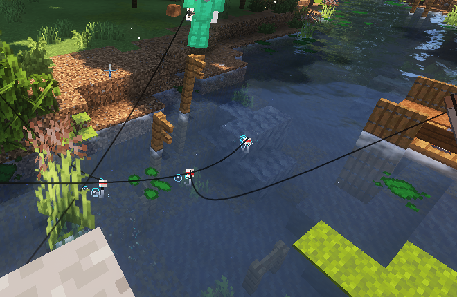
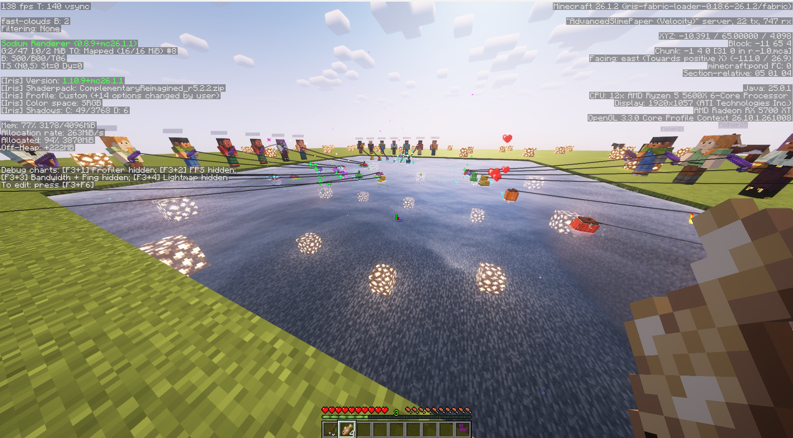

# Test FishonMCBobber

Custom, recolourable, animated bobbers for FishOnMC. Vanilla clients, no mods.

## Why I made this

after Quit from last year and comeback I'm still really really love this server. I'm always kept seeing suggestions for bobber skins and bobber recolours after searching for it in discord when I think of this server need THE BOBBER but none of them got a clear answer; some were told it isn't possible. So instead of another suggestion, I took my time on weekends built a working solution.

It's free :3 use it, change it, or ignore it.

[](https://youtu.be/A2qw3Nf55a4)

| Today: one flat sprite for everyone | With Bobber |
| --- | --- |
|  |  |

## What it does
- Each player's bobber is a 3D model that rides the real hook, so it follows it everywhere, including in a minigame.
- Recolourable per player. Animations for waiting, bite, hooked, caught and escaped.
- Players without the resource pack see the normal vanilla bobber.
- Included: `default`, `duck`, `lilypad`, `lantern`, `magic_ball`, `butterfly`.

## Install
1. Put `release/FishOnBobber-0.1.0.jar` in `plugins/` and restart.
2. Merge `release/FishOnBobber-pack.zip` into the server resource pack (keep the two atlas files, or textures render
   pink and black).
3. Cast a rod. `/bobber menu` picks a bobber and colours; tune everything in `config.yml`, then `/bobber reload`.

Base version is Paper 1.21.11 with Java 21. The same jar is tested on Paper 26.1.2 with Java 25.
The included resource pack declares support for both client pack formats, 75 through 84.

## Hooking into existing plugins (optional)

```java
// Equipped bobber, e.g. from a cosmetics tab:
player.getPersistentDataContainer().set(new NamespacedKey("fishon", "selected_skin"), PersistentDataType.STRING, "duck");
player.getPersistentDataContainer().set(new NamespacedKey("fishon", "selected_colors"), PersistentDataType.STRING, "#3f5bff,#ffd23f");

// End of a fishing minigame, before removing the hook (plays the matching ending):
hook.getPersistentDataContainer().set(new NamespacedKey("fishon", "result"), PersistentDataType.STRING, "caught"); // or "escaped"
```

## Size, performance, safety

- Plugin 49 KB, pack 13 KB.
- Compatibility tested on Paper 1.21.11 (Java 21) and Paper 26.1.2 (Java 25): the same jar loaded, created a
  display for a cast bobber, and cleaned it up when the player left on both versions.
- 50 players fishing at once: no measurable tick-time difference (2.83 ms with and without it). Details in
  [TEST-RESULTS.md](TEST-RESULTS.md).
- No network or file access, no reflection; it only reacts to fishing events after other plugins.
- Reproducible build: `cd plugin && gradlew :bobber:build` gives the same SHA-256 as `release/SHA256SUMS.txt`.
